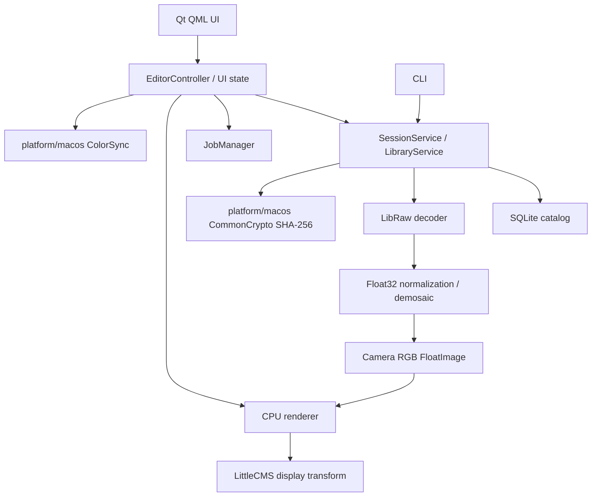

# Architecture

## Layers and dependencies



The core uses C++20 and has no Qt dependency. QML declares layout and bindings;
it does not open SQLite, decode RAW or process pixels. `SessionService` is shared
by desktop, CLI and integration tests. macOS-specific code lives under
`platform/macos`; there are no speculative Windows abstractions.

## Implemented modules

- `core/raw`: bounded LibRaw sensor decoding, metadata and validation. Does not
  invoke `dcraw_process`. `unpack_thumb` is confined to Library thumbnails.
- `core/image`: Float32 Bayer data, bilinear interpolation, camera color matrix.
- `core/render`: area-averaged camera RGB preview and shared CPU Develop reference path.
- `core/color`: scene-linear sRGB to arbitrary RGB monitor ICC, via LittleCMS.
- `core/metadata`: typed EXIF values; absent numbers remain `std::optional`.
- `core/edits`: validated typed Develop document; schema version 4.
- `core/presets`: validated subset merge of implemented settings groups.
- `core/catalog`: SQLite connection per worker operation and migrations through 5.
- `core/jobs`: bounded queue, interactive priority, cancellation, state, progress
  and error storage.
- `apps/shared`: open/restore/save and import/recovery workflows independent of GUI.
- `apps/desktop`: Qt editor controller, bounded paged LibraryModel and asynchronous thumbnail provider.
- `apps/cli`: explicit-catalog machine-readable commands.

Future `core/masks`, `cache`, `search`, `ai` are described by
the roadmap and will be created with their first implementation. Empty feature
classes are not counted as functionality.

## RAW and color pipeline

```text
LibRaw open/unpack (integer sensor samples)
→ validate sensor bounds / memory budget / Bayer CFA
→ subtract per-channel and patterned black levels in floating point
→ normalize against sensor white level
→ project bilinear demosaic in camera RGB
→ area-averaged camera RGB preview, max 2560 px (export retains original size)
→ As Shot/manual WB gains
→ LibRaw camera-to-sRGB matrix
→ scene-linear Float32 sRGB (unclipped)
→ Exposure = RGB × 2^EV
→ luminance tone and color corrections
→ monitor ICC through LittleCMS
→ oriented 8-bit RGBA display raster
```

8-bit conversion occurs only at the display boundary. The preview retains
negative RGB and values above 1 until the output transform. An empty monitor
profile explicitly targets sRGB. On macOS the controller reads the active
window's ColorSync monitor profile and schedules a new CPU render on screen
change. This is an SDR display implementation; HDR presentation, gamut warnings,
embedded input ICC, selectable output spaces and proofing are future work.

The Qt scene graph normally uses its macOS Metal RHI for presentation. Pixel
processing remains CPU in M0. The planned Metal backend must implement this
reference pipeline with numerical tolerance tests, not replace it with an
unrelated rendering graph.

## Threading, autosave and shutdown

The GUI owns editor state. Small bounded preset collection I/O is synchronous; RAW, render and catalog workflows use workers. The I/O job lane has one worker so open, restore and
catalog saves are ordered. Interactive preview uses a separate one-worker lane.
New render requests cancel obsolete jobs; revision checks prevent stale images
from replacing current UI state. Cancellation is checked per row and supplied
to LibRaw's progress callback. No exception crosses a Qt queued callback.

Develop updates debounce for 180 ms. SQLite writes use `BEGIN IMMEDIATE`, WAL,
`synchronous=FULL`, foreign keys and a busy timeout. Normal window close waits
asynchronously for the pending transaction. On failure the UI retains the edit,
reports the error and offers retry. A failed save blocks close and photo switch.
A forced kill can lose an uncommitted debounce interval; the last committed
edit remains durable. This is not described as zero-loss recovery.

## Catalog and integrity

Migration 1 creates `assets`, `edit_documents`, `session`, `schema_migrations`
and indexes for checksum, capture date and rating. Every imported source has a
UUID, canonical path and SHA-256. Metadata is persisted separately from edits.
Opening an existing path preserves the edit document and checks its checksum. Modified
originals are not silently reassociated with prior edits. Missing sources cause
a visible error; their catalog row and edits remain intact.

Migration 3 adds collections/membership and checkpointed import sessions/items.
Future migrations add versions, keywords, export sessions and render cache entries. A newer unsupported schema is refused rather
than overwritten. Automated backups and crash recovery UI are planned for 0.9.

## Memory and cache

Inputs are capped at 512 MB and 100 MP; LibRaw's raw allocation budget is 512 MB.
One Develop/export decode runs on the editor I/O lane; at most two independent
Library thumbnail jobs can decode RAW when embedded previews are unavailable. Full Float32 data is released after generation of
the current 2560 px floating-point preview. At 1:1 the future viewer will request
a full render; M0 exposes Fit only. Library has a 512 MiB disk thumbnail cache, oldest-use eviction, two workers and
a 96-request admission limit. Its key is source checksum plus original pipeline
version; thumbnails are bounded to 384 px. The metadata LRU has 16×128 rows.
Edited render-cache keys will additionally include edit revision, resolution and
ICC profile hash.

## AI providers

AI is planned. Denoise, segmentation and embeddings will have independent core
provider interfaces, with optional Core ML implementations in `platform/macos`.
No cloud calls or telemetry are present. New provider contracts must be added
with an ADR and real workflow tests.

Cancellation uses a shared atomic token defined in `core/jobs/Cancellation.h`.
It avoids dependence on `std::stop_token`, which is absent from Xcode 16 libc++
despite C++20 language support, and is used consistently by decoder/render jobs.

## Develop and export

ADR 0006 defines the shared camera-space pipeline, reference Temperature/Tint,
luminance remapping and immutable export snapshots. Version 2 migration rebuilds
the edit table transactionally and preserves M0 exposure/revision/timestamps.
Independent correction bits disable processing while retaining parameter values.

The bounded per-session history records one slider gesture as one operation.
Undo/Redo updates the same document and uses the same autosave/render path.
Session changes establish a new history baseline; history is not durable yet.

Export rechecks source SHA-256 and decodes full resolution on the I/O lane.
ImageIO encodes JPEG/PNG/TIFF16, using an explicitly embedded deterministic sRGB
ICC profile. It never uses monitor ICC. TIFF16 is quantized directly from Float32,
without an 8-bit intermediate. A sibling temporary output is finalized and
synced before atomic link/rename installation. Queued load/export cancellation
uses independent cooperative tokens, so completion callbacks still release UI
state even if cancellation precedes job execution.

## Library and import

ADR 0007 records the paged model and checkpoint protocol. Filtering and pages
run on the read worker; edits run on a separate write worker; import has its own
cooperative cancellation token. Selection is by asset UUID independently of page
residency; explicit Select All stores IDs for the filtered set. No SQLite, source
file stat or RAW decoding runs on the GUI thread. Normal close requests both
editor-save completion and import cancellation/checkpoint completion.

Copy records a staged item before filesystem installation, streams into an owned
sibling temporary file, checks SHA-256, fsyncs and links without replacement.
Asset insertion and terminal item state share a SQLite transaction. Recovery
atomically claims a dead-owner session before processing it; concurrent apps
cannot recover the same session. Duplicate policy is persisted in the journal.
Changed published files are preserved; originals are never removed by recovery.
SQLite WAL setup retries BUSY/LOCKED for at most three seconds at concurrent
initialization; upgrades recheck the schema under BEGIN IMMEDIATE. Current-schema readers
do not take a writer lock and remain usable during WAL writes.

## Advanced color and updates

Catalog migration 3→4 retains Library state and preceding corrections while adding
four curve parameters, normalized point arrays and eight HSL bands. Child rows
and the main edit row are one transaction. Saved-but-incomplete advanced rows are
reported as corruption. Neutral defaults preserve older renders. The PCHIP point
curves and parametric/HSL processing run in perceptual sRGB around the existing
linear pipeline; export shares this implementation.

UpdateController bridges QML to Sparkle's standard updater through an ARC-managed
Objective-C++ delegate. Scheduled checks use gentle reminders in the bell;
installation remains Sparkle's native UI. A deferred installation block waits
for EditorController pending/failed saves, load, export and Library writes/imports.
The embedded Ed25519 public key validates archives. The private key stays in the
release owner's Keychain or the repository Actions secret. Qt/core never process
an update ZIP or replace their own running executable.

## User presets

ADR 0009 originally defines schema-1 preset JSON and atomic shared collection storage beside
the catalog. A core subset merge preserves every excluded group and the As Shot
mode. The desktop owns a separate temporary hover snapshot, which affects only
preview rendering. Apply/Paste send the merged document through existing history,
autosave and export code. Preset storage has no RAW or catalog paths in exported
documents. ADR 0011 extends it to schema 2 with the Detail group and legacy reads.

## Batch settings

ADR 0010 defines whole-selection transactions and a disk-backed TEMP Undo journal
on a dedicated worker connection. Single-photo and batch writes share the validated
parent/curve/HSL writer. Conflict checks occur under the same write lock as Undo.
The editor drains autosave before an external batch and adopts an active-document
snapshot captured before commit, without issuing a stale follow-up save. The UI
locks mutation and guards close/update readiness through the complete operation.

## Detail sharpening

SharpeningPass is a shared spatial stage after pointwise DevelopPipeline and
before ICC/quantization in display, PNG/JPEG and TIFF16. It retains two luminance
planes and a bounded row ring, with per-row cancellation. Preview carries its
reduction scale so Radius stays in original-image pixels. Option diagnostics are
transient editor display state and never enter persistence/export. Catalog 5/edit
4 and preset 2 preserve legacy settings with neutral sharpening; see ADR 0011.
