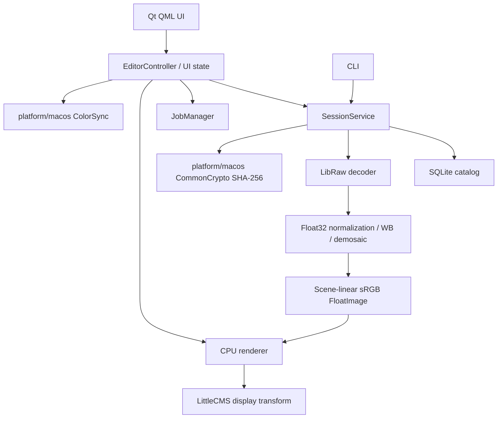

# Architecture

## Layers and dependencies



The core uses C++20 and has no Qt dependency. QML declares layout and bindings;
it does not open SQLite, decode RAW or process pixels. `SessionService` is shared
by desktop, CLI and integration tests. macOS-specific code lives under
`platform/macos`; there are no speculative Windows abstractions.

## Implemented modules

- `core/raw`: bounded LibRaw sensor decoding, metadata and validation. Does not
  invoke `dcraw_process`, `unpack_thumb` or an embedded-JPEG pipeline.
- `core/image`: Float32 Bayer data, bilinear interpolation, camera color matrix.
- `core/render`: area-averaged standard preview and CPU Exposure reference path.
- `core/color`: scene-linear sRGB to arbitrary RGB monitor ICC, via LittleCMS.
- `core/metadata`: typed EXIF values; absent numbers remain `std::optional`.
- `core/edits`: validated exposure document; schema version 1.
- `core/catalog`: SQLite connection per worker operation and migration 1.
- `core/jobs`: bounded queue, interactive priority, cancellation, state, progress
  and error storage.
- `apps/shared`: open/restore/save workflow independent of GUI.
- `apps/desktop`: Qt controller and thread-safe QQuickImageProvider.
- `apps/cli`: explicit-catalog machine-readable commands.

Future `core/masks`, `cache`, `export`, `presets`, `search`, `ai` are described by
the roadmap and will be created with their first implementation. Empty feature
classes are not counted as functionality.

## RAW and color pipeline

```text
LibRaw open/unpack (integer sensor samples)
→ validate sensor bounds / memory budget / Bayer CFA
→ subtract per-channel and patterned black levels in floating point
→ normalize against sensor white level
→ As Shot WB gains
→ project bilinear demosaic
→ LibRaw camera-to-sRGB matrix
→ scene-linear Float32 sRGB (unclipped)
→ area-averaged standard preview, max 2560 px
→ Exposure = RGB × 2^EV
→ monitor ICC through LittleCMS
→ oriented 8-bit RGBA display raster
```

8-bit conversion occurs only at the display boundary. The preview retains
negative RGB and values above 1 until the output transform. An empty monitor
profile explicitly targets sRGB. On macOS the controller reads the active
window's ColorSync monitor profile and schedules a new CPU render on screen
change. This is an SDR display implementation; HDR presentation, gamut warnings,
embedded input ICC, selectable output spaces and proofing are future work.

The Qt scene graph normally uses its macOS Metal RHI for presentation. Pixel
processing remains CPU in M0. The planned Metal backend must implement this
reference pipeline with numerical tolerance tests, not replace it with an
unrelated rendering graph.

## Threading, autosave and shutdown

The GUI owns state only. The I/O job lane has one worker so open, restore and
catalog saves are ordered. Interactive preview uses a separate one-worker lane.
New render requests cancel obsolete jobs; revision checks prevent stale images
from replacing current UI state. Cancellation is checked per row and supplied
to LibRaw's progress callback. No exception crosses a Qt queued callback.

Exposure updates debounce for 180 ms. SQLite writes use `BEGIN IMMEDIATE`, WAL,
`synchronous=FULL`, foreign keys and a busy timeout. Normal window close waits
asynchronously for the pending transaction. On failure the UI retains the edit,
reports the error and offers retry. A failed save blocks close and photo switch.
A forced kill can lose an uncommitted debounce interval; the last committed
edit remains durable. This is not described as zero-loss recovery.

## Catalog and integrity

Migration 1 creates `assets`, `edit_documents`, `session`, `schema_migrations`
and indexes for checksum, capture date and rating. Every imported source has a
UUID, canonical path and SHA-256. Metadata is persisted separately from edits.
Opening an existing path preserves exposure and checks its checksum. Modified
originals are not silently reassociated with prior edits. Missing sources cause
a visible error; their catalog row and edits remain intact.

Future migrations add versions, collections, keywords, presets, import/export
sessions and render cache entries. A newer unsupported schema is refused rather
than overwritten. Automated backups and crash recovery UI are planned for 0.9.

## Memory and cache

Inputs are capped at 512 MB and 100 MP; LibRaw's raw allocation budget is 512 MB.
Only one decode runs at a time. Full Float32 data is released after generation of
the current 2560 px floating-point preview. At 1:1 the future viewer will request
a full render; M0 exposes Fit only. There is currently no multi-photo cache or
disk LRU. Future keys include asset checksum, edit revision, pipeline version,
resolution and ICC profile hash.

## AI providers

AI is planned. Denoise, segmentation and embeddings will have independent core
provider interfaces, with optional Core ML implementations in `platform/macos`.
No cloud calls or telemetry are present. New provider contracts must be added
with an ADR and real workflow tests.

Cancellation uses a shared atomic token defined in `core/jobs/Cancellation.h`.
It avoids dependence on `std::stop_token`, which is absent from Xcode 16 libc++
despite C++20 language support, and is used consistently by decoder/render jobs.
