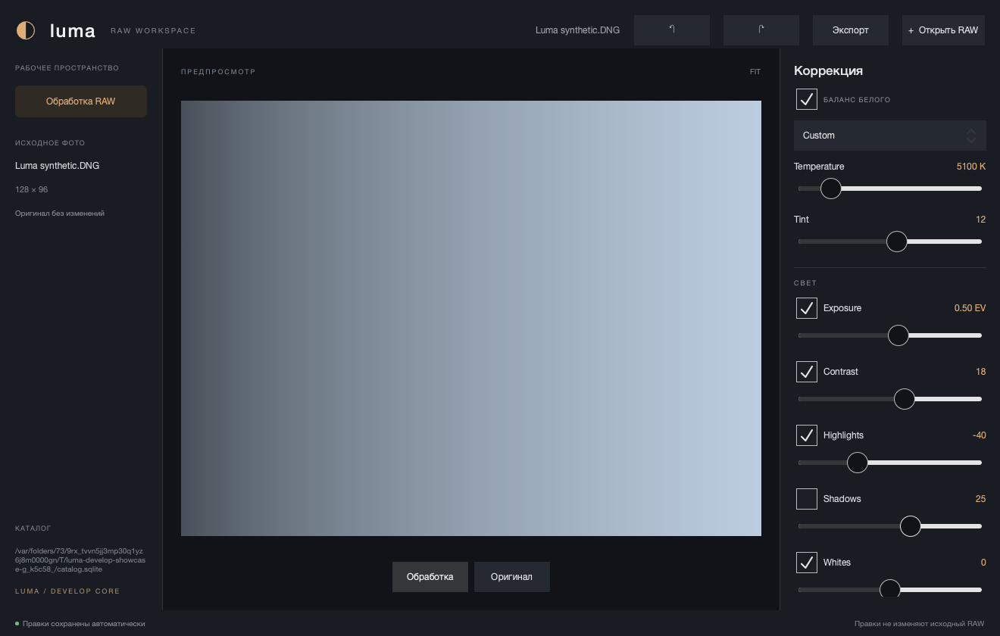

# Luma

Open-source non-destructive RAW photo editor for macOS.

Luma is a local-first photo workspace for Apple Silicon, built with C++20,
Qt 6/QML, LibRaw, SQLite and LittleCMS. No account or cloud service is required.
The product requirements originated under the working name Photon; Luma is the
project name used for implementation.



## Current milestone: 0.2 — Develop Core

- ✅ CMake project and Qt/QML application shell.
- ✅ Real sensor decode through LibRaw, with a project-owned floating-point Bayer pipeline.
- ✅ As Shot white balance, bilinear demosaic and camera-to-linear-sRGB transform.
- ✅ Temperature/Tint, As Shot and WB presets evaluated before the camera color matrix.
- ✅ Exposure, Contrast, Highlights, Shadows, Whites, Blacks, Vibrance and Saturation.
- ✅ Independent correction switches, gesture-based Undo/Redo, reset and original comparison.
- ✅ Full-resolution JPEG, PNG and 16-bit TIFF export with embedded sRGB ICC.
- ✅ Camera, lens information, ISO, shutter, aperture and focal length.
- ✅ SQLite catalog with WAL, foreign keys, migration, transactions and durable autosave.
- ✅ Automatic restoration of the active photo and Exposure after restart.
- ✅ Fit viewer, resizable panels, drag-and-drop and cancellable decoding.
- ✅ ColorSync display profile → LittleCMS display transform; rerender on screen change.
- ✅ Shared core used by desktop, CLI and tests.
- ✅ Nikon D7500 restart acceptance, unit/integration tests and public macOS CI.
- 🗓 Advanced Develop, library grid, masks, presets and Metal image processing.

Supported platform: **macOS 14+ / Apple Silicon / arm64**. Intel, Windows and
Linux are outside the current scope.

### Image support

M0 implements **integer Bayer RAW** only, including Nikon NEF and Bayer DNG.
LibRaw can decode other Bayer camera formats, but those are not claimed as
verified until they have acceptance coverage. X-Trans, monochrome RAW,
floating-point/RGB DNG and JPEG/HEIF/TIFF ingestion are planned.
Develop never uses the embedded JPEG as its image source.

This is a foundation milestone, not a daily-use Lightroom replacement.
Bilinear demosaic is a reference implementation; advanced demosaic, highlight
reconstruction, noise reduction and production camera profiles remain planned.

## Build and run

```bash
git clone --branch codex/develop-core https://github.com/yakut-sekonts/Luma.git
cd Luma
./scripts/bootstrap.sh
export PATH="$PWD/.tools/venv/bin:$PATH"
cmake -S . -B build -G Ninja -DCMAKE_BUILD_TYPE=RelWithDebInfo
cmake --build build
ctest --test-dir build --output-on-failure
open build/Luma.app
```

See [BUILDING.md](BUILDING.md) for dependency setup, packaging and private RAW tests.
M0 is in [PR #2](https://github.com/yakut-sekonts/Luma/pull/2). Stage 0.2 builds on it;
the commands above select the Develop implementation branch.
Use `--catalog /path/to/catalog.sqlite` to select an isolated catalog. Without
this option, the app uses its macOS application-data directory. RAW files stay
at their original paths. The catalog contains absolute paths and editing data;
it is local user data and must not be committed.

```bash
build/bin/luma open /path/to/photo.NEF --catalog /path/to/catalog.sqlite
build/bin/luma exposure 1.25 --catalog /path/to/catalog.sqlite
build/bin/luma develop temperature=5350 tint=12 highlights=-35 vibrance=20 --catalog /path/to/catalog.sqlite
build/bin/luma export /path/to/output.tif --catalog /path/to/catalog.sqlite
build/bin/luma restore --catalog /path/to/catalog.sqlite
build/bin/luma catalog verify --catalog /path/to/catalog.sqlite
```

## Development

[Roadmap](ROADMAP.md) · [Architecture](ARCHITECTURE.md) ·
[Requirements](docs/REQUIREMENTS.md) · [Contributing](CONTRIBUTING.md)

Only project-generated test images and code may be published. Private RAW
acceptance assets are external and are skipped when not supplied.

Licensed under [Apache-2.0](LICENSE). Third-party components retain their own
licenses; see [THIRD_PARTY_LICENSES.md](THIRD_PARTY_LICENSES.md).

## Develop and export scope

Temperature spans 2000–25000 K and Tint spans −150…150. Manual WB uses a
reference white-point approximation; As Shot uses the RAW camera gains.
Auto WB, eyedropper, highlight reconstruction, persistent history, Versions,
curves, detail and calibrated camera profiles remain planned. Undo/Redo retains
up to 200 operations in the current active-photo session. Double-click resets a
slider; Cmd+Z / Cmd+Shift+Z undo and redo.

Export uses an immutable edit snapshot, the original resolution, sRGB and no
source EXIF/GPS. JPEG quality is selectable; TIFF is 16-bit. A destination is
not overwritten unless explicitly selected, and the RAW/catalog cannot be
replaced. Export is cancellable. Resize, selectable spaces, metadata options,
output sharpening, batch export and DNG are later work.
