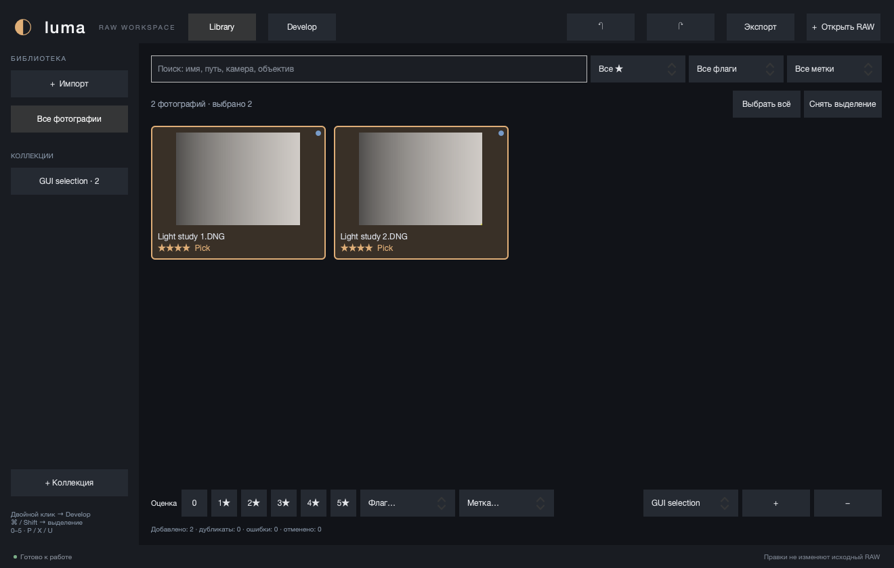

# Luma

Open-source non-destructive RAW photo editor for macOS.

Luma is a local-first photo workspace for Apple Silicon, built with C++20,
Qt 6/QML, LibRaw, SQLite and LittleCMS. No account or cloud service is required.
The product requirements originated under the working name Photon; Luma is the
project name used for implementation.


## First release: v0.3.0

[Download for macOS Apple Silicon](https://github.com/yakut-sekonts/Luma/releases/tag/v0.3.0) ·
[Release notes / known issues](docs/releases/v0.3.0.md)

DMG and ZIP contain a standalone application; Qt SDK and Homebrew are not needed.
The build is ad-hoc signed and not notarized. Installation instructions and
checksums accompany the release. Professional Develop and presets remain 0.4.

## Included: 0.3 — Library

- ✅ CMake project and Qt/QML application shell.
- ✅ Real sensor decode through LibRaw, with a project-owned floating-point Bayer pipeline.
- ✅ As Shot white balance, bilinear demosaic and camera-to-linear-sRGB transform.
- ✅ Temperature/Tint, As Shot and WB presets evaluated before the camera color matrix.
- ✅ Exposure, Contrast, Highlights, Shadows, Whites, Blacks, Vibrance and Saturation.
- ✅ Independent correction switches, gesture-based Undo/Redo, reset and original comparison.
- ✅ Full-resolution JPEG, PNG and 16-bit TIFF export with embedded sRGB ICC.
- ✅ Camera, lens information, ISO, shutter, aperture and focal length.
- ✅ SQLite catalog with WAL, foreign keys, migration, transactions and durable autosave.
- ✅ Automatic restoration of the active photo and Exposure after restart.
- ✅ Fit viewer, resizable panels, drag-and-drop and cancellable decoding.
- ✅ ColorSync display profile → LittleCMS display transform; rerender on screen change.
- ✅ Shared core used by desktop, CLI and tests.
- ✅ Nikon D7500 restart acceptance, unit/integration tests and public macOS CI.
- ✅ Add/Copy import of files and folders, duplicate detection and per-file journal checkpoints.
- ✅ Lazy original thumbnails, virtualized grid/filmstrip and bounded metadata paging.
- ✅ Single/multi/range selection, ratings, Pick/Reject, color labels and manual collections.
- ✅ Basic search and combined metadata/collection filters.
- 🗓 Advanced Develop, masks, presets and Metal image processing.

Supported platform: **macOS 14+ / Apple Silicon / arm64**. Intel, Windows and
Linux are outside the current scope.

### Image support

M0 implements **integer Bayer RAW** only, including Nikon NEF and Bayer DNG.
LibRaw can decode other Bayer camera formats, but those are not claimed as
verified until they have acceptance coverage. X-Trans, monochrome RAW,
floating-point/RGB DNG and JPEG/HEIF/TIFF ingestion are planned.
Develop never uses the embedded JPEG as its image source.

This is a foundation milestone, not a daily-use Lightroom replacement.
Bilinear demosaic is a reference implementation; advanced demosaic, highlight
reconstruction, noise reduction and production camera profiles remain planned.

## Build and run

```bash
git clone --branch v0.3.0 https://github.com/yakut-sekonts/Luma.git
cd Luma
./scripts/bootstrap.sh
export PATH="$PWD/.tools/venv/bin:$PATH"
cmake -S . -B build -G Ninja -DCMAKE_BUILD_TYPE=RelWithDebInfo
cmake --build build
ctest --test-dir build --output-on-failure
open build/Luma.app
```

See [BUILDING.md](BUILDING.md) for dependency setup, packaging and private RAW tests.
M0 is in [PR #2](https://github.com/yakut-sekonts/Luma/pull/2), Develop Core in
[PR #4](https://github.com/yakut-sekonts/Luma/pull/4), Library in
[PR #6](https://github.com/yakut-sekonts/Luma/pull/6). the first release includes all three stages.
The commands above select the immutable release tag.
Use `--catalog /path/to/catalog.sqlite` to select an isolated catalog. Without
this option, the app uses its macOS application-data directory. Add keeps RAW files
at their original paths; Copy registers verified copies in the chosen destination. The catalog contains absolute paths and editing data;
it is local user data and must not be committed.

```bash
build/bin/luma open /path/to/photo.NEF --catalog /path/to/catalog.sqlite
build/bin/luma exposure 1.25 --catalog /path/to/catalog.sqlite
build/bin/luma develop temperature=5350 tint=12 highlights=-35 vibrance=20 --catalog /path/to/catalog.sqlite
build/bin/luma export /path/to/output.tif --catalog /path/to/catalog.sqlite
build/bin/luma restore --catalog /path/to/catalog.sqlite
build/bin/luma catalog verify --catalog /path/to/catalog.sqlite
```

## Development

[Roadmap](ROADMAP.md) · [Architecture](ARCHITECTURE.md) ·
[Requirements](docs/REQUIREMENTS.md) · [Contributing](CONTRIBUTING.md)

Only project-generated test images and code may be published. Private RAW
acceptance assets are external and are skipped when not supplied.

Licensed under [Apache-2.0](LICENSE). Third-party components retain their own
licenses; see [THIRD_PARTY_LICENSES.md](THIRD_PARTY_LICENSES.md).

## Develop and export scope

Temperature spans 2000–25000 K and Tint spans −150…150. Manual WB uses a
reference white-point approximation; As Shot uses the RAW camera gains.
Auto WB, eyedropper, highlight reconstruction, persistent history, Versions,
detail and calibrated camera profiles remain planned. Undo/Redo retains
up to 200 operations in the current active-photo session. Double-click resets a
slider; Cmd+Z / Cmd+Shift+Z undo and redo.

Export uses an immutable edit snapshot, the original resolution, sRGB and no
source EXIF/GPS. JPEG quality is selectable; TIFF is 16-bit. A destination is
not overwritten unless explicitly selected, and the RAW/catalog cannot be
replaced. Export is cancellable. Resize, selectable spaces, metadata options,
output sharpening, batch export and DNG are later work.

## Library scope

Use Import to choose files/folders and Add or Copy. Duplicates are detected by
SHA-256 plus size and skipped by default. Copy creates a unique session directory
and a subdirectory per file; it never overwrites a source or existing destination.
Cancel keeps completed checkpoints. Startup recovers only dead-owner sessions,
registering verified complete copies and preserving changed published files.
Per-file failures and their source paths remain in the local import journal.

Double-click opens a sensor-decoded photo in Develop. Cmd-click toggles selection;
Shift-click selects a range; Cmd+A selects the filtered set. Keys 0–5 rate,
P/X/U set Pick/Reject/Unflag. Search covers filename/path/camera/lens; rating, flag,
label and manual collection filters combine before pagination. Collections are
references to assets; deleting one preserves originals and edits.

The model caches at most 16 × 128 metadata rows; grid and filmstrip virtualize
delegates. Lazy original thumbnails use two workers, a 96-request admission limit
and a 512 MiB disk cache in `<catalog>.luma-cache/thumbnails`. Embedded JPEGs are
used only for Library previews; Develop always reads sensor data. The 100k-row
metadata fixture verifies bounded paging and selection, not performance of
100,000 real photos. Edited thumbnails, Move, smart collections, import naming/
backup templates, keywords, XMP and missing-file relinking remain later work.

```bash
build/bin/luma import add /path/to/raw-folder --catalog /path/to/catalog.sqlite
build/bin/luma import copy /path/to/destination /path/to/raw-folder --catalog /path/to/catalog.sqlite
build/bin/luma library --rating 4 --flag 1 --catalog /path/to/catalog.sqlite
build/bin/luma collections --catalog /path/to/catalog.sqlite
```



## In development: Curves, HSL and macOS updates

The current development branch adds RGB and per-channel point curves,
parametric Shadows/Darks/Lights/Highlights, an eight-band HSL mixer and targeted
photo gestures. These use the same processing in preview and export, and save
atomically with edit schema 3 / catalog schema 4. Neutral curves and HSL preserve
the preceding Develop output. Presets, Detail, Crop and Optics remain later 0.4 work.

A bell in the toolbar shows scheduled update reminders. Check manually or opt out
of daily checks in its popover. Install opens Sparkle's native release/install UI;
Sparkle verifies the signed ZIP, replaces the app and relaunches it. Luma waits
for successful autosave and ongoing imports/exports before allowing relaunch.
Update checks send no photo/catalog data or system profiling payload.

The published v0.3.0 binary has no updater and needs one manual installation of
the first updater-enabled release. Future release publication requires the
repository signing secret; see [macOS updates](docs/UPDATES.md).
